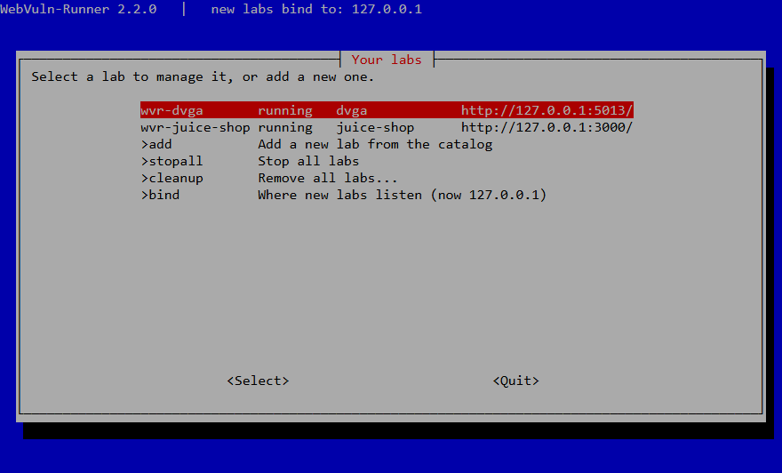
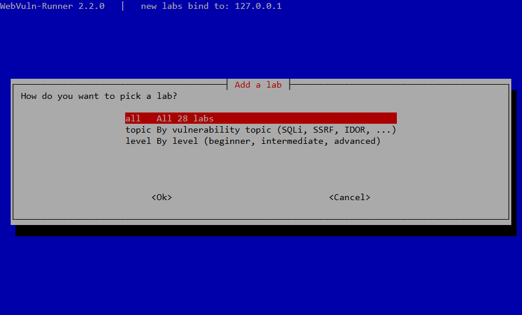
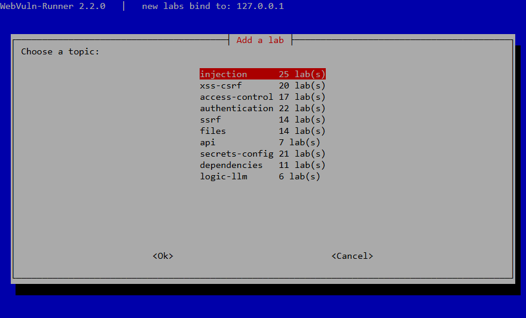
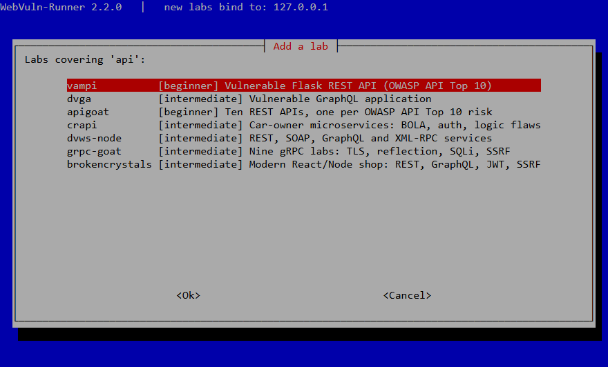
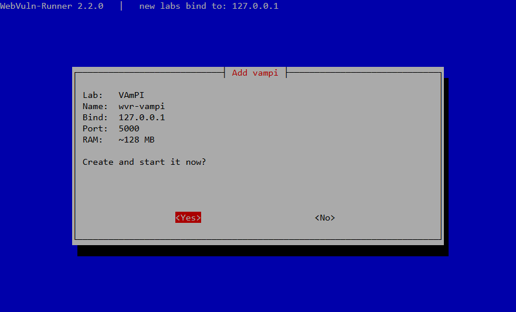
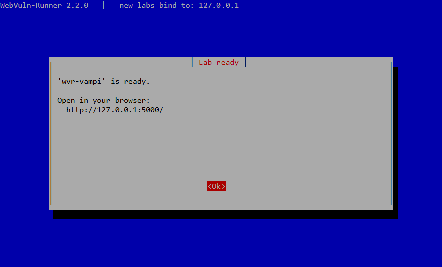
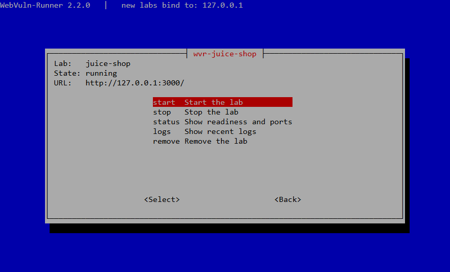
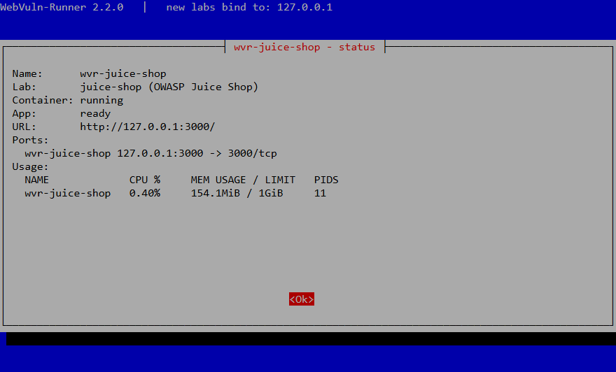

<div align="center">


# WebVuln-Runner

[](https://github.com/yusufarbc/webvuln-runner/actions/workflows/ci.yml)
[](https://github.com/yusufarbc/webvuln-runner/releases)
[](https://github.com/yusufarbc/webvuln-runner/stargazers)
[](https://github.com/yusufarbc/webvuln-runner/issues)
[](LICENSE)

Start deliberately vulnerable web apps, APIs and benchmark targets in Docker — from a terminal menu or one command — published on `127.0.0.1` by default.

</div>

---

## Table of Contents
- [Features](#features)
- [Safety model](#safety-model)
- [Quick start](#quick-start)
- [Usage](#usage)
- [Supported labs](#supported-labs)
- [Installation](#installation)
- [Adding a lab](#adding-a-lab)
- [Development and tests](#development-and-tests)
- [Web catalog](#web-catalog)
- [Roadmap](#roadmap)
- [Disclaimer](#disclaimer)
- [License](#license)

## Features
- **Lab manager, not a launcher:** create, start, stop, inspect, view logs and remove labs; several labs (and several copies of one lab) run side by side, each on its own port.
- **Safe defaults:** labs listen on `127.0.0.1` only; exposing one to your network is an explicit, warned opt-in.
- **Only touches its own containers:** everything WebVuln-Runner creates is labelled `io.webvuln-runner.managed=true`; nothing else on the host is listed, stopped or removed.
- **Readiness checks:** the container being "running" is not the same as the app being ready — WebVuln-Runner waits until the app answers and tells you when it does.
- **Single-container and Docker Compose labs:** multi-service labs such as OWASP crAPI and NodeGoat start as one unit.
- **Beyond classic web labs:** REST and GraphQL APIs, Node.js, Java, Python and PHP stacks, and the OWASP Benchmark for measuring SAST/DAST tools.
- **One TUI for every lab:** a terminal menu to add, start, stop, inspect and remove labs. The same actions are also available as commands (see [Command line](#command-line)), which the tests use.
- **Pick by what you want to learn:** every lab is tagged with one or more of 10 vulnerability topics (injection, XSS & CSRF, access control, authentication, SSRF, files, API, secrets & config, dependencies, logic & LLM) and a level. Use `webvuln-runner catalog --topic ssrf --level beginner`, the menu's "By topic" option, or the filters on the web catalog.
- **One catalog:** [`src/catalog.json`](src/catalog.json) drives the TUI, the CLI, this README's lab table and the [web catalog](https://yusufarbc.github.io/webvuln-runner/). It records each lab's license and the date it was last verified to start.

## Safety model
The labs are **intentionally vulnerable**. Treat every one of them as hostile code.

- Labs publish on `127.0.0.1`. Use `--bind 0.0.0.0` (or the TUI's bind option) only on an isolated lab network.
- Every lab runs on its own Docker network, so one lab cannot reach another. The integration test checks this by name and by IP.
- Lab containers run with `no-new-privileges`, a 1024-process limit, a memory limit (at least 512 MB, or twice the lab's expected RAM) and at most 2 CPUs. A lab that genuinely breaks under these limits can opt out in the catalog (`"hardening": false`).
- Compose labs must follow the same rules, and `scripts/check-compose-policy.sh` enforces them in CI. Every service must carry the WebVuln-Runner label and `no-new-privileges`. Ports must be published on `${WVR_BIND}`. `container_name`, privileged mode, host networking or PID namespaces, and Docker socket mounts are not allowed. This rule is why BrokenCrystals ships without its upstream `watchtower` service.
- Docker isolates processes, but it is not a security boundary you should rely on against a compromised container. Do not run labs on machines holding sensitive data, and never on production infrastructure.
- Running Docker requires root, or membership in the `docker` group — which is equivalent to root on that host. WebVuln-Runner itself does not need root; it needs access to the Docker daemon.
- Some labs attack the *client* rather than wait to be attacked. DVMCP's challenges (tool poisoning, token theft and others) target the AI/MCP client that connects to it. Use a throwaway client with no access to real files, API keys or a shell.
- Images come from third parties (see each lab's source link). The catalog pins version tags where upstream publishes them; a [weekly audit](.github/workflows/image-audit.yml) checks that every image can still be pulled.

## Quick start
```sh
# Download the installer of a tagged release, read it, then run it
curl -fsSLO https://raw.githubusercontent.com/yusufarbc/webvuln-runner/v2.2.1/installers/install.sh
less install.sh
sudo bash install.sh

# Start a lab and open the URL it prints
sudo webvuln-runner up juice-shop
```

## Usage
### Interactive menu (TUI)
Run `webvuln-runner` without arguments. Use the arrow keys to move, Enter to choose, Tab to switch between buttons and Esc to go back.

**Main menu.** It lists your labs with their state and URL, followed by the actions: add a lab, stop all labs, remove all labs, and choose where new labs listen. Pick **Quit** to leave; your labs keep running.



**Add a lab.** Choose how to find one: the whole catalog, by vulnerability topic, or by level.



Picking by topic shows how many labs cover each topic:



Then choose a lab from the matching ones:



Accept or change the suggested name and host port (a free port is pre-filled), then confirm:



WebVuln-Runner pulls the image, starts the lab and waits until the app answers. Then it shows the URL to open. If the lab has default credentials or first-run steps, they are shown next.



**Manage a lab.** Select a lab in the main menu to start or stop it, check its status, read its recent logs or remove it. Removing asks twice and asks separately before deleting data volumes.



**Status** shows whether the app answers, its ports and its CPU and memory use. For a failed lab it also shows the exit code and the last log lines.



### Command line
```text
webvuln-runner catalog               list labs that can be started
webvuln-runner list                  list your labs and their state
webvuln-runner up <lab> [options]    create and start a lab
    --name NAME     instance name (default: wvr-<lab>)
    --port PORT     host port for the lab's main port (default: first free one)
    --bind ADDR     address to publish on (default: 127.0.0.1)
    --no-wait       do not wait for the app to answer
webvuln-runner start|stop|status <name>
webvuln-runner stop --all            stop every lab
webvuln-runner stats [name]          CPU and memory of running labs
webvuln-runner logs <name> [--tail N]
webvuln-runner rm <name> [--volumes]
webvuln-runner rm --all --yes [--volumes]   remove every lab (never other containers)
webvuln-runner validate [catalog.json]
webvuln-runner uninstall
```

Example:
```console
$ webvuln-runner up dvga
Lab 'wvr-dvga' (dvga) started.
  web: http://127.0.0.1:5013/
Waiting for 'wvr-dvga' to answer (up to 90s)...
'wvr-dvga' is ready: http://127.0.0.1:5013/

$ webvuln-runner up dvga --name dvga-2      # a second copy gets the next free port
$ webvuln-runner list
NAME                     LAB                STATE        URL
dvga-2                   dvga               running      http://127.0.0.1:5014/
wvr-dvga                 dvga               running      http://127.0.0.1:5013/
```

Exit codes: `0` ok, `1` error, `2` usage error, `3` lab started but did not answer in time.

`list` and the menu show each lab's state:
- `running` or `stopped`.
- `starting` or `unhealthy`, from the image's own health check.
- `restarting`.
- `partial n/m`, when only some containers of a multi-container lab run.
- `failed`, when a container exited with an error code. `status` then shows the exit code and the last log lines.
`WVR_BIND` changes the default bind address, and `WVR_HEALTH_TIMEOUT` changes the default readiness timeout in seconds.

## Supported labs
<!-- catalog:start -->
| Lab | ID | Category | Level | Topics | Type | Default port(s) | License | Verified |
|---|---|---|---|---|---|---|---|---|
| [OWASP Juice Shop](https://github.com/juice-shop/juice-shop) | `juice-shop` | web | beginner | injection, xss-csrf, access-control, authentication, ssrf, files, secrets-config, dependencies, logic-llm | image | 3000 | MIT | 2026-10-17 |
| [DVWA](https://github.com/digininja/DVWA) | `dvwa` | web | beginner | injection, xss-csrf, authentication, files | image | 8081 | GPL-3.0 | 2026-10-17 |
| [OWASP WebGoat](https://github.com/WebGoat/WebGoat) | `webgoat` | training | beginner | injection, xss-csrf, access-control, authentication, ssrf, files, secrets-config, dependencies | image | 8080, 9090 | GPL-2.0-or-later | 2026-10-17 |
| [bWAPP](http://www.itsecgames.com/) | `bwapp` | web | beginner | injection, xss-csrf, authentication, ssrf, files, secrets-config, dependencies | image | 8082 | unknown | 2026-10-17 |
| [OWASP Mutillidae II](https://github.com/webpwnized/mutillidae) | `mutillidae` | web | beginner | injection, xss-csrf, access-control, authentication, files, secrets-config | image | 8083 | GPL-3.0 | 2026-10-17 |
| [XVWA](https://github.com/s4n7h0/xvwa) | `xvwa` | web | beginner | injection, xss-csrf, access-control, authentication, ssrf, files, secrets-config, dependencies | image | 8084 | GPL-3.0 | 2026-10-17 |
| [VAmPI](https://github.com/erev0s/VAmPI) | `vampi` | rest-api | beginner | injection, access-control, authentication, api | image | 5000 | MIT | 2026-10-17 |
| [DVNA](https://github.com/appsecco/dvna) | `dvna` | web | beginner | injection, xss-csrf, access-control, authentication, secrets-config, dependencies | image | 9091 | MIT | 2026-10-17 |
| [VulnLab](https://github.com/Yavuzlar/VulnLab) | `vulnlab` | web | beginner | injection, xss-csrf, access-control, authentication, files, dependencies, logic-llm | image | 8085 | CC-BY-NC-SA-4.0 | 2026-10-17 |
| [SQLi-Labs](https://github.com/Audi-1/sqli-labs) | `sqli-labs` | web | beginner | injection | image | 8086 | unknown | 2026-10-17 |
| [OWASP VulnerableApp](https://github.com/SasanLabs/VulnerableApp) | `vulnerableapp` | web | intermediate | injection, xss-csrf, authentication, ssrf, files | image | 9092 | Apache-2.0 | 2026-10-17 |
| [PyGoat](https://github.com/adeyosemanputra/pygoat) | `pygoat` | web | beginner | injection, xss-csrf, access-control, authentication, ssrf, secrets-config, dependencies | image | 8100 | MIT | 2026-10-17 |
| [DVGA](https://github.com/dolevf/Damn-Vulnerable-GraphQL-Application) | `dvga` | graphql | intermediate | injection, xss-csrf, access-control, authentication, ssrf, files, api, secrets-config | image | 5013 | MIT | 2026-10-17 |
| [Hackazon](https://github.com/rapid7/hackazon) | `hackazon` | web | intermediate | injection, xss-csrf, files | image | 8087 | Apache-2.0 | 2026-10-17 |
| [OWASP Benchmark](https://github.com/OWASP-Benchmark/BenchmarkJava) | `owasp-benchmark` | benchmark | advanced | injection, xss-csrf, files, secrets-config | image | 8443 | GPL-2.0 | 2026-10-17 |
| [DVWS (PHP)](https://github.com/snoopysecurity/dvws) | `dvws` | rest-api | intermediate | injection, authentication, ssrf, secrets-config | image | 8088 | Apache-2.0 | 2026-10-17 |
| [DSVPWA](https://github.com/sgabe/DSVPWA) | `dsvpwa` | web | beginner | injection, xss-csrf, authentication, files, secrets-config, dependencies | image | 65413 | MIT | 2026-10-17 |
| [APIGoat](https://github.com/yusufarbc/APIGoat) | `apigoat` | rest-api | beginner | access-control, authentication, ssrf, api, secrets-config, logic-llm | image | 8000, 8001-8010 | GPL-3.0 | 2026-10-17 |
| [OWASP crAPI](https://github.com/OWASP/crAPI) | `crapi` | rest-api | intermediate | injection, access-control, authentication, ssrf, api, logic-llm | compose | 8888, 8025 | Apache-2.0 | 2026-10-17 |
| [OWASP NodeGoat](https://github.com/OWASP/NodeGoat) | `nodegoat` | web | beginner | injection, xss-csrf, access-control, authentication, ssrf, secrets-config, dependencies | compose | 4000 | Apache-2.0 | 2026-10-17 |
| [DVWS-Node](https://github.com/snoopysecurity/dvws-node) | `dvws-node` | rest-api | intermediate | injection, xss-csrf, access-control, authentication, ssrf, files, api, secrets-config, dependencies | compose | 8089 | GPL-3.0 | 2026-10-17 |
| [Snyk Goof](https://github.com/snyk-labs/nodejs-goof) | `goof` | web | beginner | injection, xss-csrf, secrets-config, dependencies | compose | 3001 | Apache-2.0 | 2026-10-17 |
| [gRPC Goat](https://github.com/rootxjs/grpc-goat) | `grpc-goat` | grpc | intermediate | injection, authentication, ssrf, api, secrets-config | compose | 50051, 50052-50058 | MIT | 2026-10-17 |
| [DVMCP](https://github.com/harishsg993010/damn-vulnerable-MCP-server) | `dvmcp` | ai-mcp | intermediate | access-control, secrets-config, logic-llm | compose | 9001, 9002-9010 | unknown | 2026-10-17 |
| [OWASP WrongSecrets](https://github.com/OWASP/wrongsecrets) | `wrongsecrets` | training | beginner | secrets-config | image | 8090 | AGPL-3.0 | 2026-10-17 |
| [BrokenCrystals](https://github.com/NeuraLegion/brokencrystals) | `brokencrystals` | web | intermediate | injection, xss-csrf, access-control, authentication, ssrf, files, api, secrets-config, logic-llm | compose | 3100, 1080 | MIT | 2026-10-17 |
| [DjanGoat](https://github.com/Contrast-Security-OSS/DjanGoat) | `djangoat` | web | beginner | injection, xss-csrf, access-control, authentication, secrets-config | compose | 8110 | MIT | 2026-10-17 |
| [OWASP Security Shepherd](https://github.com/OWASP/SecurityShepherd) | `security-shepherd` | training | beginner | injection, xss-csrf, access-control, authentication, secrets-config | compose | 8445 | GPL-3.0 | 2026-10-17 |

### Labs by topic

| Topic | Labs |
|---|---|
| `access-control` | `juice-shop`, `webgoat`, `mutillidae`, `xvwa`, `vampi`, `dvna`, `vulnlab`, `pygoat`, `dvga`, `apigoat`, `crapi`, `nodegoat`, `dvws-node`, `dvmcp`, `brokencrystals`, `djangoat`, `security-shepherd` |
| `api` | `vampi`, `dvga`, `apigoat`, `crapi`, `dvws-node`, `grpc-goat`, `brokencrystals` |
| `authentication` | `juice-shop`, `dvwa`, `webgoat`, `bwapp`, `mutillidae`, `xvwa`, `vampi`, `dvna`, `vulnlab`, `vulnerableapp`, `pygoat`, `dvga`, `dvws`, `dsvpwa`, `apigoat`, `crapi`, `nodegoat`, `dvws-node`, `grpc-goat`, `brokencrystals`, `djangoat`, `security-shepherd` |
| `dependencies` | `juice-shop`, `webgoat`, `bwapp`, `xvwa`, `dvna`, `vulnlab`, `pygoat`, `dsvpwa`, `nodegoat`, `dvws-node`, `goof` |
| `files` | `juice-shop`, `dvwa`, `webgoat`, `bwapp`, `mutillidae`, `xvwa`, `vulnlab`, `vulnerableapp`, `dvga`, `hackazon`, `owasp-benchmark`, `dsvpwa`, `dvws-node`, `brokencrystals` |
| `injection` | `juice-shop`, `dvwa`, `webgoat`, `bwapp`, `mutillidae`, `xvwa`, `vampi`, `dvna`, `vulnlab`, `sqli-labs`, `vulnerableapp`, `pygoat`, `dvga`, `hackazon`, `owasp-benchmark`, `dvws`, `dsvpwa`, `crapi`, `nodegoat`, `dvws-node`, `goof`, `grpc-goat`, `brokencrystals`, `djangoat`, `security-shepherd` |
| `logic-llm` | `juice-shop`, `vulnlab`, `apigoat`, `crapi`, `dvmcp`, `brokencrystals` |
| `secrets-config` | `juice-shop`, `webgoat`, `bwapp`, `mutillidae`, `xvwa`, `dvna`, `pygoat`, `dvga`, `owasp-benchmark`, `dvws`, `dsvpwa`, `apigoat`, `nodegoat`, `dvws-node`, `goof`, `grpc-goat`, `dvmcp`, `wrongsecrets`, `brokencrystals`, `djangoat`, `security-shepherd` |
| `ssrf` | `juice-shop`, `webgoat`, `bwapp`, `xvwa`, `vulnerableapp`, `pygoat`, `dvga`, `dvws`, `apigoat`, `crapi`, `nodegoat`, `dvws-node`, `grpc-goat`, `brokencrystals` |
| `xss-csrf` | `juice-shop`, `dvwa`, `webgoat`, `bwapp`, `mutillidae`, `xvwa`, `dvna`, `vulnlab`, `vulnerableapp`, `pygoat`, `dvga`, `hackazon`, `owasp-benchmark`, `dsvpwa`, `nodegoat`, `dvws-node`, `goof`, `brokencrystals`, `djangoat`, `security-shepherd` |

28 labs. Generated from `src/catalog.json` by `scripts/gen-readme-table.sh`. "Verified" is the last date `scripts/labs-smoke.sh` started the lab successfully.
<!-- catalog:end -->

Default credentials and first-run steps are shown after a lab starts. They are also listed in the catalog under `credentials` and `notes`.

## Installation
`installers/install.sh` supports **Debian / Ubuntu / Kali**, **Fedora / RHEL / CentOS / Rocky / AlmaLinux** and **Arch Linux**. It:

1. installs Docker (from Docker's own repository on Red Hat family systems), the Compose v2 plugin where available, `whiptail`, `jq` and `curl`, and enables the Docker service;
2. downloads the release tarball, verifies it against the release's `SHA256SUMS` and refuses to install on mismatch. From 2.2.1 on, every tarball also carries a signed build provenance attestation, so you can check that it was built by this repository's release workflow and not uploaded by hand:
   ```sh
   gh release download v2.2.1 --repo yusufarbc/webvuln-runner --pattern '*.tar.gz'
   gh attestation verify webvuln-runner-2.2.1.tar.gz --repo yusufarbc/webvuln-runner
   ```
3. installs to `/usr/local/lib/webvuln-runner`, with `webvuln-runner` (and the 1.x name `WebVuln-Runner`) in `/usr/local/bin`.

Options are environment variables: `WVR_RELEASE=v2.2.1`, `WVR_DISTRO=debian|redhat|arch`, `WVR_SKIP_DEPS=1`.

**From a git checkout:** `sudo installers/install-files.sh` installs the files of the checkout. You can also run `src/webvuln-runner` directly without installing.

**Update:** run the installer of the newer release; your labs are kept. See [CHANGELOG.md](CHANGELOG.md) for what changed.

**Rollback:** if a release misbehaves, install the previous one over it. Labs and their volumes are kept:
```sh
curl -fsSLO https://raw.githubusercontent.com/yusufarbc/webvuln-runner/v2.2.0/installers/install.sh
sudo WVR_RELEASE=v2.2.0 bash install.sh
```

**Uninstall:** `sudo webvuln-runner uninstall`. It asks before removing the labs it created and never touches other containers. Pass `--remove-labs` or `--keep-labs` to skip the question when calling `/usr/local/lib/webvuln-runner/uninstall.sh` directly.

**Upgrading from 1.x:** the installer removes the old `/bin/WebVuln-Runner` and `/bin/indexApp.lst`. Containers created by 1.x carry no WebVuln-Runner label, so they do not appear in the new menu. Remove them with `docker rm -f <name>`.

Without the Compose plugin, multi-container labs are shown as unavailable and everything else works.

## Adding a lab
Add an entry to [`src/catalog.json`](src/catalog.json):

```json
{
  "id": "my-lab",
  "name": "My Lab",
  "description": "One line about what it teaches",
  "category": "web",
  "stack": ["PHP", "MySQL"],
  "type": "image",
  "image": "vendor/my-lab:1.2.3",
  "ports": [{ "name": "web", "container": 80, "host": 8099, "scheme": "http", "path": "/" }],
  "ram_mb": 256,
  "credentials": "admin / admin",
  "topics": ["sqli", "xss", "csrf"],
  "level": "beginner",
  "license": "MIT",
  "verified": "2026-10-17",
  "source": "https://github.com/vendor/my-lab"
}
```

| Field | Meaning |
|---|---|
| `category` | `web`, `rest-api`, `graphql`, `grpc`, `ai-mcp`, `benchmark` or `training` |
| `topics` | what the lab lets you practise, from: `injection` (SQL/NoSQL, command, SSTI, XXE), `xss-csrf`, `access-control` (IDOR/BOLA, authorization), `authentication` (login, sessions, JWT), `ssrf`, `files` (path traversal, upload), `api` (API Top 10, GraphQL, gRPC), `secrets-config` (secrets, misconfiguration, crypto), `dependencies` (vulnerable components, deserialization), `logic-llm` (business logic, LLM/MCP). Take them from the lab's own documentation |
| `level` | `beginner`, `intermediate` or `advanced` |
| `license` | the upstream project's SPDX license id, or `unknown` |
| `verified` | date the lab last started successfully (`scripts/labs-smoke.sh --update-verified <id>` sets it) |
| `type` | `image` (one container) or `compose` (a Compose project, see below) |
| `image` | `repository:tag`. Use a version tag whenever upstream publishes one |
| `ports` | first entry is the main port (shown as the URL and used for the readiness check); `host` defaults must be unique across the catalog |
| `scheme` | `http`, `https`, `tcp` or `grpc` |
| `health` | optional `{ "type": "http" \| "https" \| "tcp", "path": "/ready" }` override |
| `health_timeout` | seconds to wait for readiness (default 90) |
| `env`, `workdir`, `command` | optional container environment, working directory and command |
| `mem_limit_mb`, `cpus` | optional resource limits (defaults: `max(512, 2 × ram_mb)` MB, 2 CPUs) |
| `hardening` | `false` disables no-new-privileges and the limits; only for labs that break, with the reason in `notes` |

**Compose labs** set `"type": "compose"` and `"compose": "compose/<id>/compose.yml"`. In that file:
- every service carries the `x-wvr-labels` block (see [`src/compose/nodegoat/compose.yml`](src/compose/nodegoat/compose.yml));
- every published port is written as `"${WVR_BIND:-127.0.0.1}:${WVR_PORT_<NAME>:-<default>}:<container port>"`, where `<NAME>` is the upper-cased port name from the catalog;
- `container_name` is not used, so several instances can coexist;
- every service sets `security_opt: ["no-new-privileges:true"]` (`scripts/check-compose-policy.sh` checks all of this).

Then run `src/webvuln-runner validate`, `scripts/gen-readme-table.sh` and start the lab once with `src/webvuln-runner up <id>`.

## Development and tests
```sh
src/webvuln-runner validate          # catalog schema checks
bats tests/unit                      # unit tests with a fake docker CLI
bash tests/integration.sh            # end-to-end against a real Docker daemon
scripts/check-compose-policy.sh      # security rules for every Compose lab
scripts/ci-local.sh                  # all of the CI checks above in one go
scripts/labs-smoke.sh [lab ...]      # start every (or the given) lab for real: up, ready, stop, rm
shellcheck -x src/webvuln-runner src/lib/*.sh installers/*.sh installers/*/*.sh scripts/*.sh
```
CI runs all of these on every pull request. The integration test checks that labs bind to `127.0.0.1` and that busy ports are skipped. It also checks that a container not created by WebVuln-Runner survives every command.

## Web catalog
[`index.html`](index.html) ([GitHub Pages](https://yusufarbc.github.io/webvuln-runner/)) renders the catalog with search and category filters. It also shows the command that starts each lab. It is static and read-only on purpose: a browser page cannot safely control your Docker daemon, and exposing the Docker socket to one would hand over root on your machine.

## Roadmap
WebVuln-Runner runs labs; it does not scan, test or modify them. The labs' code, images and content belong to their upstream projects. The tool only decides how they run: on loopback, on their own network, with resource limits, and without services that would endanger the host.

- Pin images that only publish `latest` by digest, and report when upstream changes them
- `webvuln-runner reset <name>` to restart a lab with clean data
- `webvuln-runner update` to pull newer catalog images
- An advanced profile for Kubernetes labs (e.g. Kubernetes Goat), which need a cluster rather than Docker alone
- Optional local API for the web catalog, with authentication

## Contributing
1. Create a branch: `git checkout -b feature/my-lab`
2. Add the lab as described in [Adding a lab](#adding-a-lab) and run the tests
3. Open a pull request describing the lab and how you tested it

Report bugs or request labs at https://github.com/yusufarbc/webvuln-runner/issues.

## Disclaimer
These applications are intentionally vulnerable. Do not expose them to the internet or run them on production infrastructure. Use them only on systems you own or are authorized to test.

## License
GNU General Public License v3.0 — see [`LICENSE`](LICENSE). Third-party lab images and the adapted Compose files keep their own licenses, noted at the top of each file under `src/compose/`.
